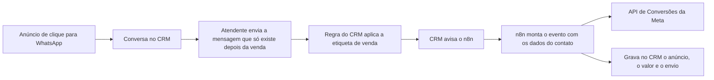

# Guia: venda real do CRM para a Meta pela API de Conversões

Este é o processo que eu sigo para a Meta saber quem **comprou**, e não só quem mandou mensagem.

Em campanha de clique para WhatsApp, a Meta só enxerga a conversa iniciada. A venda acontece depois, dentro do WhatsApp, e a Meta nunca fica sabendo. O resultado é uma campanha que aprende a trazer gente que chama, mas não necessariamente gente que compra.

O caminho é devolver a venda para a Meta pela API de Conversões. Quando a empresa tem uma mensagem padrão de pós-venda, o envio funciona sem atendente clicando em botão e sem IA lendo conversa para adivinhar o que foi venda.

## Visão geral

## 1. Achar o gatilho de verdade

Antes de automatizar, eu descubro qual mensagem a empresa envia **só depois** que a venda fechou ou o serviço aconteceu. Exemplos: instruções de cuidado depois de um procedimento, confirmação de entrega, envio de recibo.

- Eu pergunto ao cliente e não invento a frase.
- Confirmação de agendamento não serve como venda. Agendamento pode furar.
- Se só existir sinal de agendamento, o evento é de agendamento, não de compra. Mandar compra em cima de agendamento ensina a Meta a buscar gente que agenda e não aparece.
- Se não existir mensagem padrão de pós-venda, a equipe registra a venda num painel simples e o envio sai na hora do registro. É um clique por venda, mas o evento chega no mesmo dia e com os dados certos.

## 2. Conferir o gatilho nas conversas reais

Antes de ligar qualquer coisa, eu procuro a frase nas conversas que já existem no CRM. Isso mostra se a equipe realmente usa a mensagem e se o texto varia de atendente para atendente.

## 3. Marcar a venda no CRM sem depender de ninguém

No CRM de atendimento (base Chatwoot), eu monto três peças:

1. **Uma etiqueta de venda**, que também deixa a venda visível para a equipe.
2. **Uma regra de automação.** Quando sai uma mensagem que contém a frase-gatilho, a regra aplica a etiqueta. Eu uso "contém", nunca "igual a", porque a mensagem real sempre tem texto em volta.
3. **Um aviso para o n8n.** Toda conversa que muda de etiqueta avisa o fluxo.

Fechar conversa por tempo não serve de gatilho de venda. Isso é faxina da caixa de entrada, não sinal de compra.

## 4. Montar o evento no n8n

O fluxo recebe o aviso, confere se a etiqueta de venda está lá e lê as mensagens da conversa uma vez só. Com isso ele monta o evento:

- **Telefone do contato**, o identificador mais confiável em funil de WhatsApp.
- **E-mail**, quando o cliente informou na conversa.
- **Identificador do clique no anúncio** (`ctwa_clid`), quando a integração do WhatsApp entrega esse dado. Ele liga a venda ao anúncio exato.
- **Nome do evento, valor e moeda.**
- **Um identificador único da venda**, para a mesma venda não ser contada duas vezes se o aviso chegar repetido.

Telefone, e-mail e nome vão criptografados (SHA-256), como a Meta exige. Nenhum dado pessoal sai em texto aberto.

## 5. Gravar de volta no CRM

Junto com o envio para a Meta, o fluxo grava na própria conversa o anúncio de origem, o valor e se o evento foi aceito. É isso que permite calcular depois o **custo por venda de cada anúncio** com dado do CRM, sem aproximar por telefone e horário.

## 6. Testar sem contaminar a conta

- Eu deixo o fluxo desligado até o cliente confirmar a frase e o nome do evento.
- Eu testo com a ferramenta Eventos de Teste do Gerenciador de Eventos, com a aba aberta durante o envio. Código de teste sem sessão aberta faz a Meta tratar o evento como real.
- Eu leio a resposta de cada envio de teste para confirmar que ele não foi contado como venda.
- Eu ligo o fluxo de verdade só com autorização do cliente. Evento enviado não tem como ser desfeito.

## O que muda na campanha depois

Com as vendas chegando, a conta passa a ter dois números lado a lado: custo por conversa e custo por venda. Conversa barata que não vende aparece na hora.

Quando o volume de vendas permite (a Meta usa como referência cerca de 50 eventos por conjunto em 7 dias), dá para otimizar a campanha pela venda em vez da conversa.

## Erros que eu evito

- Mandar compra quando o sinal real é agendamento.
- Enviar venda à mão, em lote, uma vez por semana. Chega atrasada e não ensina a campanha.
- Reaproveitar a frase-gatilho, a etiqueta ou a regra de um cliente em outro. Cada empresa escreve diferente.
- Esquecer o identificador único da venda e contar a mesma compra duas vezes.

## Caso real (cliente anonimizado)

**Assinatura de climatização.** A empresa vende assinatura mensal pelo WhatsApp e não tinha mensagem padrão de pós-venda. Primeiro eu corrigi o pixel, que otimizava para um evento que nunca disparava (ver o [checklist de auditoria](https://github.com/DolbsK/checklist-auditoria-pixel-meta)). No começo, as assinaturas confirmadas iam para a Meta à mão, em lote. Depois eu implantei um painel de atendimento em que a equipe registra a venda, e o evento de assinatura sai na hora pela API de Conversões. Foi esse caso que me ensinou que envio em lote serve para medir, mas não para a campanha aprender.

## Ferramentas

CRM de atendimento do WhatsApp (base Chatwoot), n8n e API de Conversões da Meta.

---

Kallebe Alves · Gestor de Tráfego Pago e Automação de Marketing · [portfolio.vyzar.com.br](https://portfolio.vyzar.com.br)
